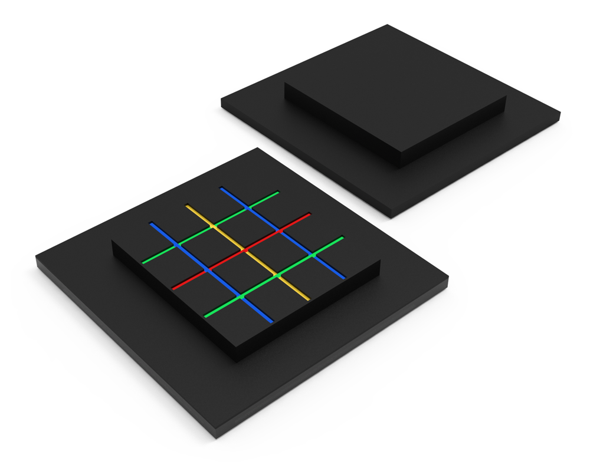
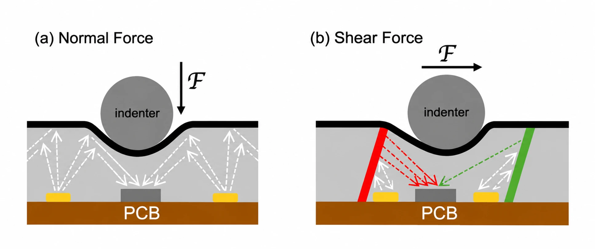
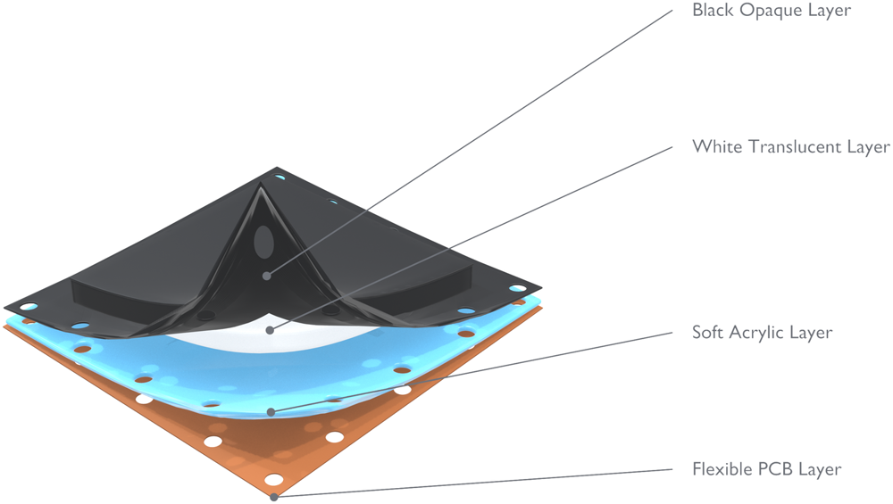
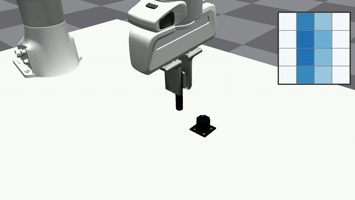
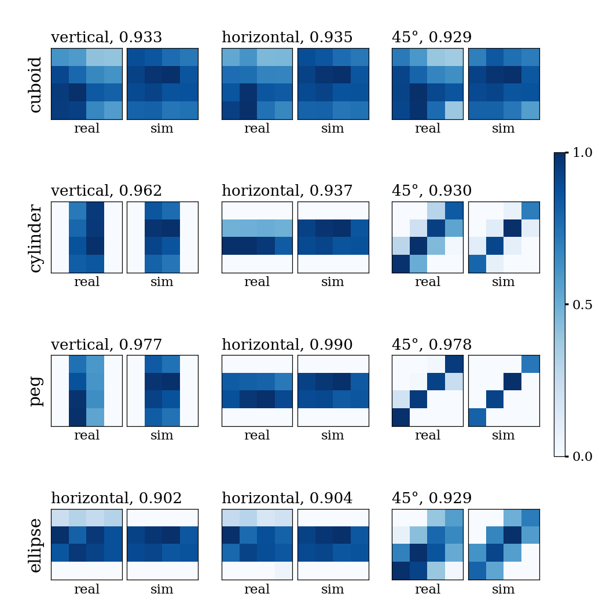

<div align="center">

<picture>
  <source media="(prefers-color-scheme: dark)" srcset="media/title_dark.png">
  
</picture>

<h3>A Flexible, Scalable, and Open-Source Optical Taxel Array</h3>

<p>
Md Rakibul Islam Prince<sup>1</sup>, John Pelan<sup>1</sup>, Zhiyuan Zhang<sup>1</sup>, Adyaa Khera<sup>1</sup>,
Katherine Pesetski<sup>1</sup>, Adeesh Desai<sup>1</sup>, Akimizu Sugiyama<sup>1</sup>, Minwoo Ki<sup>1</sup>,
Benjamin Alan Capelle<sup>1</sup>, Temitope Ibrahim Amosa<sup>1</sup>, Zijie Xu<sup>2</sup>, Yihan Huang<sup>3</sup>,
Taehun Chung<sup>4</sup>, Long Wang<sup>3</sup>, Wei Li<sup>2</sup>, Shaoting Lin<sup>4</sup>, Yu She<sup>1</sup>
<br>
<sup>1</sup>Purdue University &nbsp; <sup>2</sup>Stony Brook University &nbsp;
<sup>3</sup>Stevens Institute of Technology &nbsp; <sup>4</sup>University of Wisconsin&ndash;Madison
</p>

<a href="https://luxtac.github.io/"></a>
<a href="https://arxiv.org/abs/2611.23575"></a>

<p>
<b>Simulation of the LuxTac optical taxel array</b>
</p>



</div>

LuxTac is a scalable optical taxel array. Each taxel reads LED light scattered back from
a translucent silicone layer under a black film, so the reading falls with local
indentation depth.

<p align="center">


</p>

This repository simulates the 4x4 pad in IsaacGym with TacSL. Each simulated taxel reads
its indentation depth and maps it to the signal the real pad would report, using the
depth response measured on the real sensor.

<p align="center">

<br>
<em>Simulated peg insertion. The grid is the left pad's 4x4 reading.</em>
</p>

## Installation

```bash
git clone https://github.com/AdeeshDesai/LuxTac-Sim.git
cd LuxTac-Sim
bash install.sh
conda activate luxtac
```

`install.sh` creates the `luxtac` environment and installs IsaacGym TacSL and
luxtac-isaacgymenvs into `thirdparty/`. If the IsaacGym download fails, save
[this archive](https://drive.google.com/file/d/13dFRF9EXpzIWaJF2Z6f7BsuPUGQkPE8v/view) as
`thirdparty/IsaacGym_Preview_TacSL_Package.tar.gz` and run `install.sh` again.

## View the pad

```bash
./scripts/run_view_luxtac.sh --object peg_vert
```

Objects: `{cuboid,cylinder,ellipse,peg}_{vert,horz,deg45,deg135}`. Keys `c` / `o` close
and open the gripper.

## Sim-to-real comparison

<p align="center">

<br>
<em>Measured (left of each pair) and simulated (right) readings, with the cosine of each grasp.</em>
</p>

Real and simulated grasps are included, so this runs without a GPU:

```bash
python alignment/compare.py     # matched simulation 0.942
```

## Teleoperation

SpaceMouse teleop on an insertion task. Every episode is saved to
`data/teleop/<object>/replay_buffer.zarr`.

```bash
./scripts/run_teleop_luxtac.sh --object peg_insert --indent 6.0
./scripts/run_teleop_luxtac.sh --object usb --indent 3.0
```

| input | action |
|---|---|
| SpaceMouse | move the arm |
| LEFT / RIGHT | close / open the gripper |
| `d` | save episode |
| `r` | discard episode |
| `q` | quit |

## Policy training

Coming soon.

## Citation

```bibtex
@misc{prince2026luxtacflexiblescalableopensource,
      title={LuxTac: A Flexible, Scalable, and Open-Source Optical Taxel Array with Distributed Three-Axis Force Sensing for Tactile Robot Learning},
      author={Md Rakibul Islam Prince and John Pelan and Zhiyuan Zhang and Adyaa Khera and Katherine Pesetski and Adeesh Desai and Akimizu Sugiyama and Minwoo Ki and Benjamin Alan Capelle and Temitope Ibrahim Amosa and Zijie Xu and Yihan Huang and Taehun Chung and Long Wang and Wei Li and Shaoting Lin and Yu She},
      year={2026},
      eprint={2611.23575},
      archivePrefix={arXiv},
      primaryClass={cs.RO},
      url={https://arxiv.org/abs/2611.23575},
}
```

## License

Copyright (c) 2025 The LuxTac authors. Released under
[CC BY-NC-SA 4.0](https://creativecommons.org/licenses/by-nc-sa/4.0/) for non-commercial
use; for commercial use, contact Purdue Innovates. Third-party licences are listed in
`THIRD_PARTY_NOTICES.md`.
